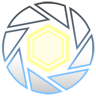

## Portal Solver Editor SDK > Reference > Structures > Common

 

Краткий справочник базовых типов данных и структур, используемых в **SDK**

## Алиасы

| Имя алиаса       | Тип        | Размер (в байтах)  |  Описание                            |
|------------------|------------|:---------------------:|--------------------------------------|
| **PseGUID**      | `uint64_t` |           8           |  Глобальный уникальный идентификатор |

## Структуры

| Имя структуры    | Поля                                                      | Размер _(в байтах)_ | Описание                    |
|------------------|-----------------------------------------------------------|:----------------------:|-----------------------------|
| **PseVector2**   | `float x`, `float y`                                      |           8            | Двухмерный вектор           |
| **PseVector3**   | `float x`, `float y`, `float z`                           |           12           | Трехмерный вектор           |
| **PseQuat**      | `float x`, `float y`, `float z`, `float w`                |           16           | Кватернион                  |
| **PseTransform** | `PseQuat quat`, `PseVector3 location`, `PseVector3 scale` |           40           | Трансформ объекта           |
| **PseColor**     | `uint8_t r`, `uint8_t g`, `uint8_t b`, `uint8_t a`        |           4            | Цвет в формате RGBA (0-255) |
